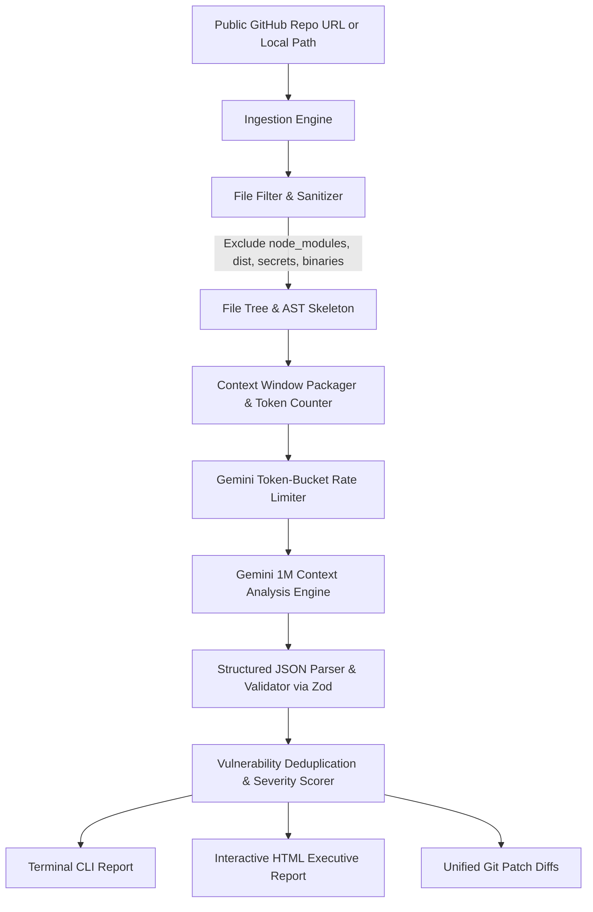

# AI CODE AUDITOR — FULL SYSTEM BLUEPRINT & ARCHITECTURE SPECIFICATION

> **Version**: 1.0.0  
> **Status**: Ready for Implementation  
> **Target Directory**: `d:\projects\code-auditor`  
> **Cost Profile**: **$0.00 / Zero API Costs** (Free Gemini API tier + Free Git tools + Free Hosting)

---

## 1. Executive Summary & Value Proposition

Traditional static analysis tools (ESLint, SonarQube, Snyk) rely either on fixed AST rule heuristics (which yield massive false-positive rates) or superficial single-file scans. Conversely, enterprise AI security tools (like Snyk DeepCode or Veracode) cost thousands of dollars per month.

**AI Code Auditor** exploits Google Gemini's **1,000,000 token context window** on the free tier to load an *entire codebase's architectural relationships at once*. It detects:
- Multi-file vulnerability cascades (e.g., tainted input in `Controller.ts` passing through `Service.ts` unsanitized into a raw SQL query in `Repository.ts`).
- Architectural decay and dead logic that single-file linters can never detect.
- Exact git-diff patch generation for every discovered defect.

---

## 2. Zero-Cost Technology Stack

| Layer | Technology | Free Tier Quota / Details |
| :--- | :--- | :--- |
| **Core Runtime** | Node.js (v20+) + TypeScript 5.x | Open Source / Local |
| **LLM Inference** | Google Gemini 2.5 Flash / 1.5 Flash via `@google/genai` | Free Tier in Google AI Studio: **15 RPM, 1M TPM, 1,500 RPD** |
| **Code Ingestion** | `isomorphic-git` / `simple-git` + GitHub REST API | Unauthenticated: 60 req/hr. Free GitHub Personal Access Token (PAT): 5,000 req/hr |
| **AST & File Filtering** | `ignore` + `fast-glob` + `@babel/parser` / `ts-morph` | Local execution (0 cost, zero latency) |
| **Storage & Cache** | SQLite via `better-sqlite3` or local JSON cache | Local file-based, zero hosting cost |
| **CLI Presentation** | `commander` + `chalk` + `ora` + `cli-table3` | Beautiful terminal output with colored severity badges |
| **Web UI (Optional)** | Next.js / Vite + Vanilla CSS | Vercel Free Hobby Tier / Cloudflare Pages |

---

## 3. Data Flow Pipeline



---

## 4. Analysis Pillars & Rubric

### Vector A: Security & Exploitability (OWASP / CWE)
- **Injection (CWE-89, CWE-78)**: Raw SQL string interpolation, shell exec with user input.
- **Broken Access Control (CWE-284)**: Unprotected admin endpoints, missing middleware guard.
- **Cryptographic & Secret Exposure (CWE-798)**: Hardcoded API keys, JWT secret defaults, AWS keys.
- **SSRF & Open Redirects (CWE-918, CWE-601)**: Unvalidated `fetch`/`axios` with user-supplied URLs.

### Vector B: Performance & Memory Leak Vectors
- **Event Listener / Stream Leaks**: Unsubscribed event emitters, open socket connections without cleanup.
- **N+1 Database Query Patterns**: Looping queries inside array maps instead of batch fetching.
- **Heavy Sync Operations**: `fs.readFileSync` or CPU-intensive crypto inside async request loops.

### Vector C: Architectural Cohesion & Clean Code
- **Cyclic Dependencies & God Objects**: Classes/modules exceeding 800 LOC doing multiple orthogonal tasks.
- **Silent Exception Swallowing**: `catch (e) {}` blocks with zero logging or recovery.
- **Type-Safety Degradation**: Widespread `any` casts that defeat compile-time validation.

### Vector D: Automated Remediation Engine
- For every High or Critical finding, the system generates a ready-to-apply **unified diff**:
```diff
- const query = `SELECT * FROM users WHERE id = '${req.params.id}'`;
+ const query = 'SELECT * FROM users WHERE id = $1';
+ const result = await db.query(query, [req.params.id]);
```

---

## 5. Rate Limiter & Token Optimization Protocol

To ensure uninterrupted operation on Google AI Studio's Free Tier:
1. **Token Estimation**: Pre-calculate tokens using character-to-token heuristic (`1 token ≈ 4 characters`).
2. **Prioritized Ingestion**: If a repository exceeds 600,000 tokens:
   - Rank 1: Config files (`package.json`, `tsconfig.json`, `docker-compose.yml`, `.env.example`).
   - Rank 2: Route handlers, controllers, middlewares (`src/api`, `src/routes`, `src/controllers`).
   - Rank 3: Core domain & database entities (`src/models`, `src/services`).
   - Rank 4: Utility functions and helpers.
3. **Leaky Bucket Limiter**: Guarantee at least 4.2 seconds between sequential prompt requests (staying well within 15 RPM).

---

## 6. Phase-by-Phase Roadmap

### Phase 1: Core Domain & Ingestion Engine (Completed)
- [x] Initialize TypeScript project with strict mode.
- [x] Define core Domain interfaces: `JobLead`, `AuditReport`, `Vulnerability`, `Severity`, `ILlmClient`.
- [x] Implement `LocalRepoReader` and `GitHubCloner` (shallow clone `git clone --depth 1`).
- [x] Implement `FileFilter` (respects `.gitignore`, ignores vendor/minified assets).

### Phase 2: Gemini Adapter & Schema-Enforced Prompts (Completed)
- [x] Integrate `@google/genai` with `gemini-2.5-flash` or `gemini-1.5-flash`.
- [x] Construct the Master Auditor System Prompt with Zod schema enforcement (`responseSchema`).
- [x] Implement `GeminiRateLimiter` with automatic retry on 429 status.

### Phase 3: CLI Runner & Report Exporters (Completed)
- [x] Build terminal CLI with `commander` (`npx audit-repo --path ./my-app`).
- [x] Create HTML report generator (single-file standalone dashboard with search, filter by severity, and syntax-highlighted diffs).
- [x] Write end-to-end tests against vulnerable test fixtures (DVWA, Juice Shop snippets).

### Phase 4: Web UI & Launch (Completed)
- [x] Build clean, lightweight web frontend (Vite/Next.js).
- [x] Public waitlist / demo page allowing visitors to audit their open-source repos.
- [x] Add "Export to GitHub Issue / PR" capability.

---

## 7. Monetization Strategy for Zero-Budget Founders

1. **Freelance Lead Magnet**: Run the tool on public GitHub repos of target freelance clients or startups; send them a high-impact, professional executive PDF report highlighting 3 critical security bugs for free, offering paid remediation.
2. **GitHub Action (Freemium)**: Free for public open-source repos; $19/mo for private organizational repos.
3. **Audit-as-a-Service**: Charge indie hackers and startups $49–$99 for an in-depth pre-launch audit report.
