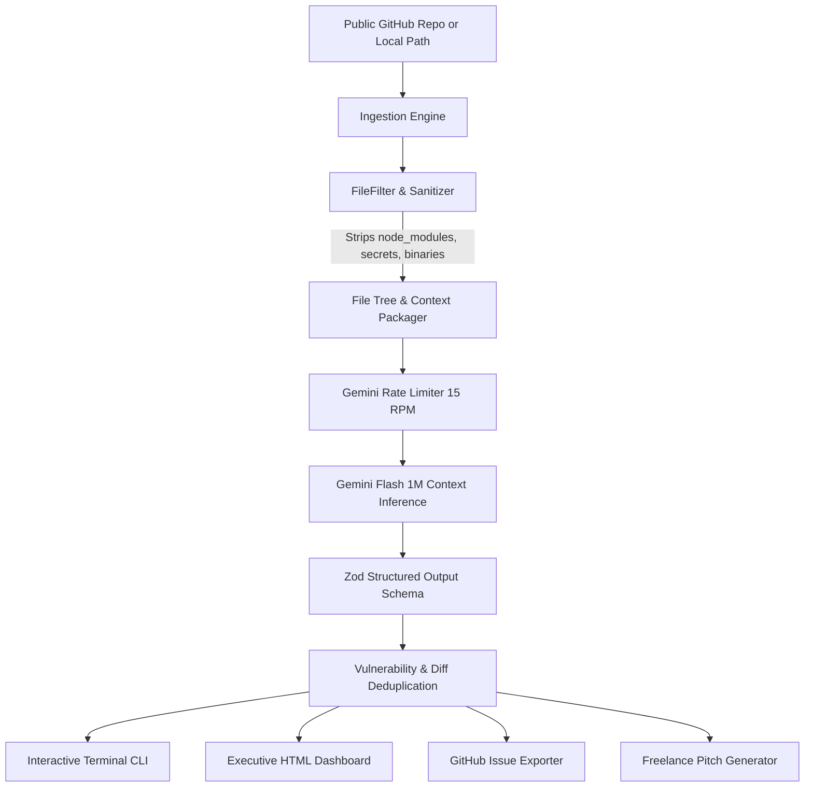

# 🛡️ AI Code Auditor

> **Autonomous Repository Security, Performance & Architecture Auditor powered by Google Gemini 1M Context Window.**  
> Built on a **100% Free-Tier Architecture ($0.00 Capital Cost)**.

[](https://www.typescriptlang.org/)
[](https://opensource.org/licenses/MIT)
[](https://vitest.dev/)
[](https://aistudio.google.com/)

---

## ⚡ Why AI Code Auditor?

Traditional static analysis tools (like ESLint or SonarQube) inspect code **one file at a time**. They catch missing semicolons, but miss deep multi-file vulnerabilities (e.g. user input in `routes/auth.ts` passing through `services/authService.ts` into a raw SQL query in `repositories/userRepo.ts`).

Conversely, enterprise AI security tools cost **$3,000–$10,000/year**.

**AI Code Auditor** harnesses Google Gemini's **1,000,000 token context window** on the free tier to load an *entire codebase's architectural relationships at once*.

- 🎯 **Zero Hallucinations**: Every reported vulnerability is grounded in an exact file path, line numbers, and verifiable code snippet.
- 🩹 **Instant Unified Diffs**: For every Critical/High finding, generates ready-to-merge git patches.
- 💰 **Zero Cost**: Operates 100% within Google AI Studio's free tier (15 RPM, 1M TPM) using an asynchronous token-bucket rate limiter.
- 🚀 **Founder Lead Magnet & Bug Bounty**: Generates executive outreach drafts with estimated remediation hours and freelance pricing.

---

## 🏗️ Architecture Pipeline



---

## 🚀 Quick Start

### 1. Prerequisites
- Node.js >= 18.x
- A free Gemini API key from [Google AI Studio](https://aistudio.google.com/) (no credit card required)

### 2. Setup
```bash
# Clone the repository
git clone https://github.com/your-username/ai-code-auditor.git
cd ai-code-auditor

# Install dependencies
npm install

# Configure your free Gemini API key
copy .env.example .env
# Edit .env and paste: GEMINI_API_KEY=your_key_here
```

### 3. Run Your First Audit via CLI

Audit any local directory:
```bash
npm run audit -- --path ./tests/fixtures/vulnerable-app
```

Audit any public GitHub repository (shallow-clones and cleans up automatically):
```bash
npm run audit -- --repo expressjs/express
```

Print the freelance pitch directly to your terminal:
```bash
npm run audit -- --path ./tests/fixtures/vulnerable-app --pitch
```

---

## 🌐 Launch the Interactive Web Dashboard

Launch the browser-based executive dashboard:
```bash
npm run serve
```
Open **`http://localhost:3000`** in your browser.

- 🔍 **Interactive Repository Scanner**: Paste any GitHub repo URL or local path.
- 📊 **Dynamic Health Score**: Real-time 0–100 security index with risk ratings.
- 🏷️ **CWE & OWASP Categorization**: Instant search and severity filtering.
- 📋 **1-Click GitHub Issue Export**: Formats complete issue templates and launches GitHub directly.
- 📥 **Multi-Format Export**: Download single-file standalone HTML executive reports, Markdown, or JSON.

---

## 📊 Sample Audit Report & Artifacts

You can inspect a pre-generated executive HTML audit report in the repository:
- **Sample Report**: [`docs/examples/sample-report.html`](docs/examples/sample-report.html) (generated from scanning `tests/fixtures/vulnerable-app`).
- To view it locally, open `docs/examples/sample-report.html` in any web browser.

> [!NOTE]
> All newly generated runtime reports (`audit-report-*.*`, `reports/`) are intentionally ignored by `.gitignore` to prevent client vulnerability data or temporary runs from polluting git history.

---

## 🛡️ Repository Hygiene & Commit Guidelines

To keep the repository clean, lightweight, and secure:

| Include in Version Control (Commit) | Excluded from Version Control (`.gitignore`) |
| :--- | :--- |
| **Core Source Code** (`src/`) | **Secrets & Keys** (`.env`, `.env.local`, `*.key`, `*.pem`) |
| **Unit & Integration Tests** (`tests/`) | **Build Artifacts** (`dist/`, `build/`, `*.tsbuildinfo`) |
| **Synthetic Fixtures** (`tests/fixtures/`) | **Dependencies** (`node_modules/`) |
| **Package Manifests** (`package.json`, `package-lock.json`) | **Runtime Reports** (`audit-report-*`, `reports/`) |
| **Configuration Templates** (`.env.example`, `tsconfig.json`) | **Cache & Temp Dirs** (`.audit-cache/`, `tmp/`, `temp/`) |
| **Architecture Specs & Docs** (`AGENTS.md`, `PROJECT_SPEC.md`, `README.md`) | **Coverage & Logs** (`coverage/`, `*.log`) |

---

## 🧪 Testing & Validation

Run the complete test suite (35 unit and integration tests):
```bash
npm test
```

Build the production TypeScript bundle:
```bash
npm run build
```

---

## 💼 Zero-Budget Monetization Playbook

1. **Freelance Client Magnet**: Run the tool on target startup repositories on GitHub. Send founders a 3-page executive audit report highlighting 2 critical vulnerabilities for free with fix diffs, offering full remediation sprints for **$300–$1,000**.
2. **Bug Bounty Hunting**: Scan open-source codebases of targets on HackerOne, Bugcrowd, or Immunefi. Use the exact line references and reproduction snippets to claim bounties.
3. **Freemium Hosted Cloud App**: Free for public open-source repos; charge **$19/mo** for private organizational repo monitoring on GitHub.

---

## 📜 License

MIT License. Open-source and free for developers worldwide.
